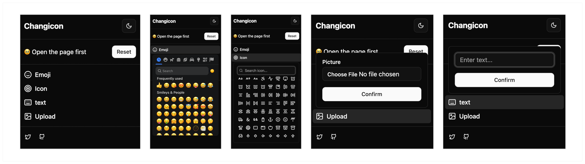
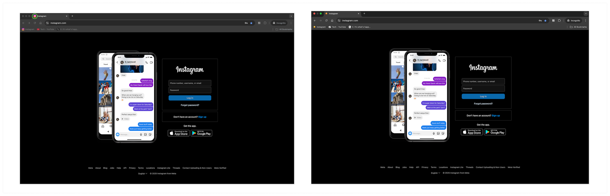

# Changicon - Website (Tab) Icon Customizer

A simple yet powerful Chrome extension that allows you to customize website (browser tab) icons. Built with WXT + React + shadcn/ui + Tailwind CSS.




## Features

- **Text icons** - up to 2 characters, auto-fitted to the icon
- **Emoji icons** - pick any emoji
- **Icon library** - search icons from lucide and use them as SVG icons
- **Image upload** - PNG / JPG / WebP / GIF / SVG; fill the icon (crop) or fit the whole image
- **Rounded tile style** - consistent white rounded background for all icon types
- **Per-page icons** - matches `host + pathname`, applied automatically on page load
- **Restore in place** - `Reset` puts the site's original favicon back without reloading
- **Icon background** - white tile or transparent (configured in the settings section; applies to new icons)
- **Manage saved icons** - clear all saved icons from the footer
- **Dark / light / system theme**

## Permissions

- `storage` - save the selected icons and the theme
- `activeTab` - read the URL/favicon of the tab the popup was opened for
- `scripting` - inject the content script into tabs that were already open before install/update

Content scripts run on `http(s)` pages to apply the icon. Icons are generated locally; no remote code is loaded.

## Development

### Prerequisites

- Node.js >= 20 (see `.nvmrc`)
- pnpm (version pinned in `package.json`)

### Install

```bash
pnpm install
```

### Dev mode

```bash
pnpm dev
```

### Build

```bash
pnpm build
```

### Checks

```bash
pnpm compile   # TypeScript
pnpm lint      # ESLint
pnpm test      # Vitest
pnpm check     # all of the above + build
```

## Installation

### Web Store

Open [Changicon](https://chromewebstore.google.com/detail/changicon/pcnnpfojchdoapfnaanpibdkjbdmglhi) directly.

### Manual install

1. `pnpm build`
2. Open Chrome Extensions page (`chrome://extensions/`)
3. Enable "Developer mode"
4. Click "Load unpacked"
5. Select the `.output/chrome-mv3` directory of this project

## Contributing

Issues and Pull Requests are welcome!

## License

[MIT License](LICENSE)
