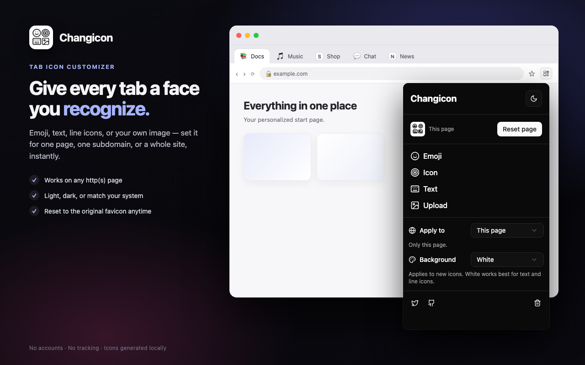
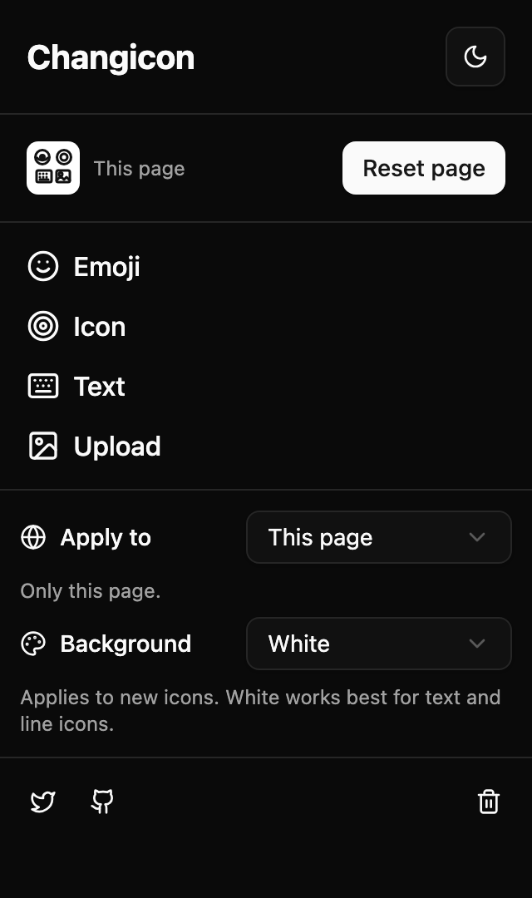
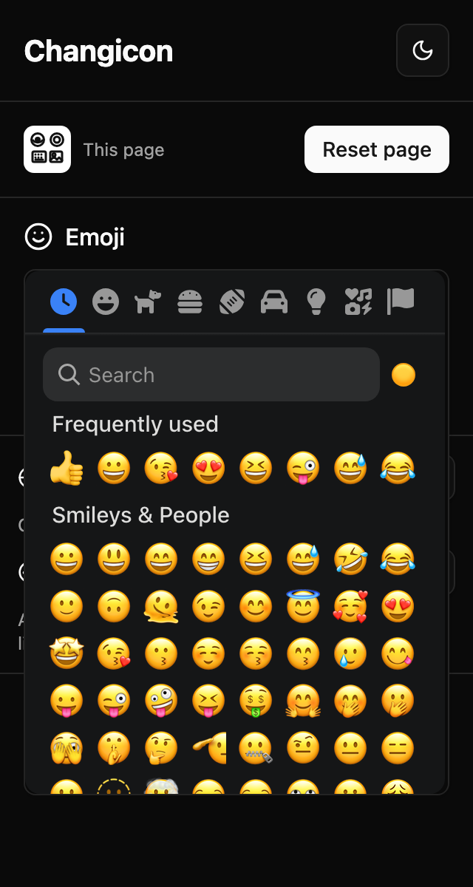
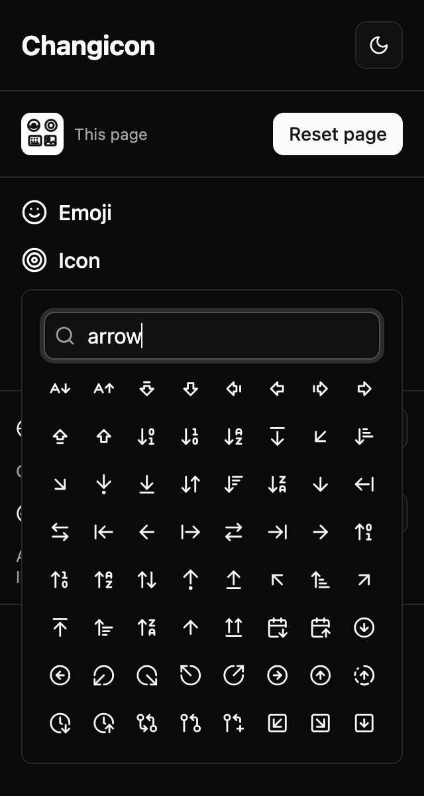
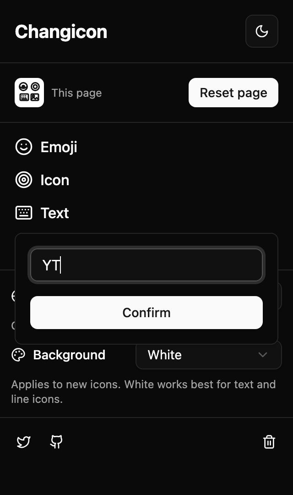
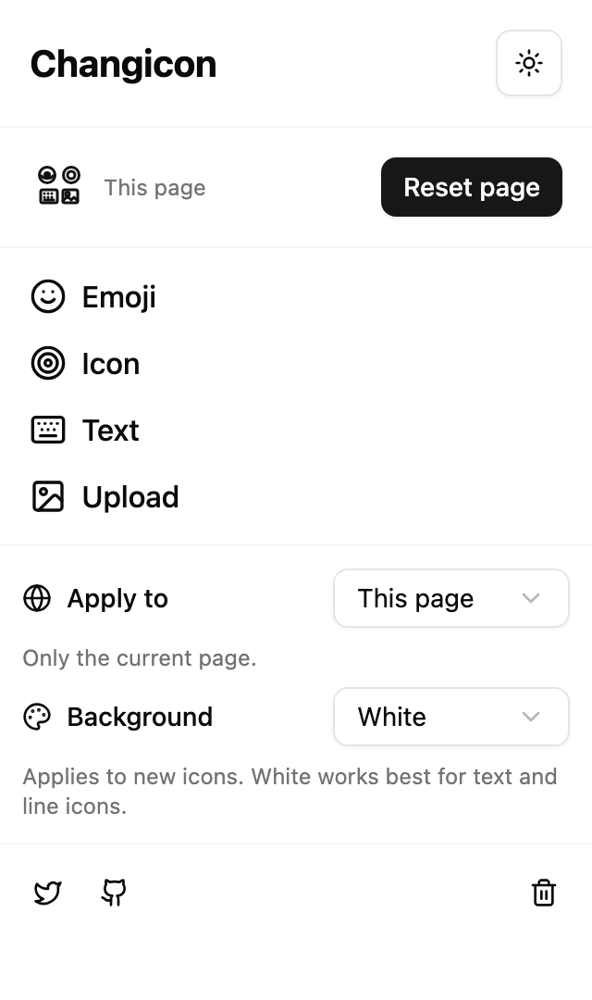
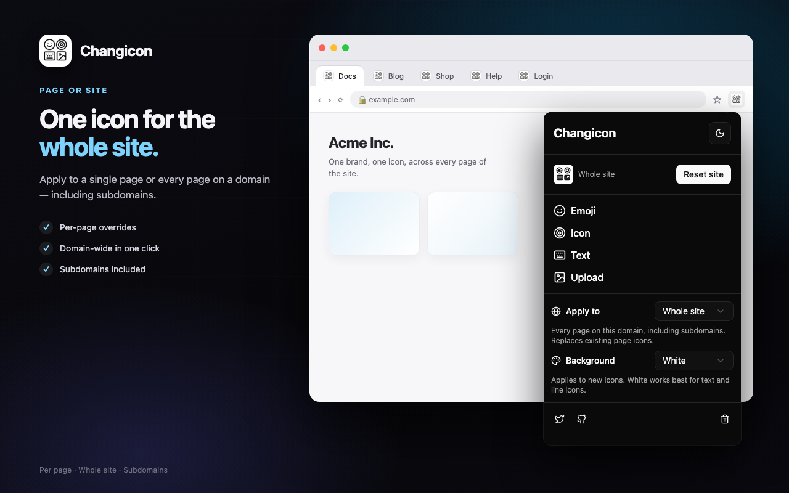

# Changicon

**Give every browser tab a face you recognize.**

Changicon is a Chrome extension that replaces a page's favicon with an icon you
choose — an emoji, up to two characters, a Lucide icon, or an image you upload.
Apply it to one page, one subdomain, or a whole site. Everything is generated and stored
locally; there is no account, no tracking, and no network access.

[](https://chromewebstore.google.com/detail/changicon/pcnnpfojchdoapfnaanpibdkjbdmglhi)
[](https://github.com/niexia/customize-tab-icon/actions/workflows/ci.yml)
[](LICENSE)
[](CHANGELOG.md)



## Why Changicon

Tab bars get crowded, and most favicons look the same at 16 px. Changicon lets
you label a tab the way your brain already does — with an emoji, a two-letter
badge, a recognizable line icon, or a picture from your own library. It is a
small, local utility: no account, no sync, no analytics, no remote code.

- **Four icon sources** — emoji (full picker + search), text (up to 2 characters,
  auto-fitted), Lucide icons (searchable), and image upload (PNG, JPG, WebP, GIF,
  SVG; up to 5 MB).
- **Three scopes** — set one page, every page on the current hostname
  (`This subdomain`, `This domain` on a bare domain, `This server` on
  localhost/IP), or the whole registrable domain including subdomains. Narrower
  scopes win, and applying a wider one replaces the narrower icons it covers.
- **Instant, in place** — the tab icon changes immediately; reset restores the
  site's own favicon without reloading.
- **Consistent tiles** — white rounded tile or transparent background, chosen in
  the settings section.
- **Image fit** — crop to fill the tile, or fit the whole image with background.
- **Light, dark, or system** — a popup that matches your browser.
- **Private by design** — icons are generated on your device and stored in
  `chrome.storage.local`; the extension makes no requests.

## Screenshots

<table>
  <tr>
    <td align="center"><br /><sub><b>Main popup</b> — page, subdomain, or site</sub></td>
    <td align="center"><br /><sub><b>Emoji</b> — search the full library</sub></td>
    <td align="center"><br /><sub><b>Icons</b> — Lucide search</sub></td>
  </tr>
  <tr>
    <td align="center"><br /><sub><b>Text</b> — up to two characters</sub></td>
    <td align="center"><br /><sub><b>Light theme</b> — or dark / system</sub></td>
    <td align="center"><a href="./docs/architecture.md"></a><br /><sub><b>Whole site</b> — <a href="./docs/architecture.md">how it works</a></sub></td>
  </tr>
</table>

Screenshots are generated from the real popup bundle with a mock extension
environment; see [`store/README.md`](store/README.md). The five store-ready
1280×800 images are in [`store/assets/`](store/assets).

## Features

| | |
| --- | --- |
| **Emoji** | Full emoji-mart picker with search, lazy-loaded |
| **Text** | One or two characters, auto-fitted; white or transparent |
| **Icon library** | Lucide icons with instant search and SVG output |
| **Upload** | 5 MB limit; cover/crop or contain/fit; rounded consistent tile |
| **Scope** | `This page` (`host + pathname`), `This subdomain` (`host`, port included), or `Whole site` (registrable domain, subdomains included) |
| **Precedence** | Page beats subdomain beats site; reset reveals the next broader icon |
| **Reset** | Restores the page's original favicon without reloading; works on pages with no icon link |
| **Clear all** | Removes every saved icon and original favicon URL; keeps preferences |
| **Theme** | Dark, light, or system; mirrored to `localStorage` for a flash-free popup |
| **Privacy** | Local storage, local generation, no network, no remote code, no telemetry |

## Install

### Chrome Web Store

[Open Changicon in the Chrome Web Store](https://chromewebstore.google.com/detail/changicon/pcnnpfojchdoapfnaanpibdkjbdmglhi).

### From source

```bash
pnpm install
pnpm build
```

Open `chrome://extensions/`, enable **Developer mode**, choose **Load unpacked**,
and select `.output/chrome-mv3`.

## How it works

The popup generates a 128 px icon as a data URL and stores it in
`chrome.storage.local` under a key for the page (`host + pathname`) or the
registrable site. A content script on each `http(s)` page reads the effective
icon (page first, then site), rewrites the page's `<link rel="icon">`, and
watches for storage, SPA URL changes, and the site replacing its own icon. Reset
restores the original attributes — or, on pages with no icon link, keeps a link
pointing at the original `/favicon.ico`.

There is no background service worker. Tabs opened before install/update get the
content script injected by the popup on demand.

The full design, storage schema, and sequence diagrams are in
[`docs/architecture.md`](docs/architecture.md).

## Permissions

| Permission | Why |
| --- | --- |
| `storage` | Save icons, original favicon URLs, and preferences locally |
| `activeTab` | Read the current tab's URL/favicon when you open the popup |
| `scripting` | Inject the content script into tabs opened before install/update |
| `*://*/*` | Replace the favicon on any regular web page you choose; update other open tabs on the same site |

The content script only reads and rewrites `<link rel="icon">` elements. It does
not read page text, form values, cookies, or network requests. The extension has
no server and makes no requests. See
[`store/README.md`](store/README.md) for the listing copy and permission
justifications, and [`docs/privacy.md`](docs/privacy.md) for the policy.

Chrome's own pages (`chrome://`), extension pages, and the Chrome Web Store
cannot be customized because Chrome does not allow content scripts there.

## Development

Prerequisites: Node.js 22+ (see `.nvmrc`) and pnpm (version pinned in
`package.json`).

```bash
pnpm install       # also runs wxt prepare
pnpm dev           # WXT dev server
pnpm build         # production build -> .output/chrome-mv3
pnpm compile       # TypeScript
pnpm lint          # ESLint
pnpm test          # Vitest
pnpm check         # compile + lint + test + build
pnpm zip           # build + zip for the store
```

Regenerate the store and README images from the real popup (requires a local
Chrome/Chromium):

```bash
pnpm store:assets
```

The harness serves the built popup locally with a mock `chrome.*` environment and
captures it headlessly. The mock is development-only and never ships in the
extension.

## Release

1. Generate the version bump and changelog with
   [changelogen](https://github.com/unjs/changelogen): `pnpm changelog --minor`
   (or `--patch` / `--major`). Preview with `pnpm exec changelogen`; it updates
   `package.json` + `CHANGELOG.md` only.
2. Update the docs markers, diagrams, and `store/README.md`; run `pnpm check`.
3. Commit, tag `vX.Y.Z`, push the tag. The
   [release workflow](.github/workflows/release.yml) runs checks, zips, and
   attaches the archive to the GitHub Release.
4. Upload the zip in the Chrome Web Store dashboard (the legacy v1.1 API used by
   WXT 0.20 is retired; manual submission is intentional).

The full checklist, changelog options, and rollback steps are in
[`docs/release-process.md`](docs/release-process.md).

## Documentation

| Document | Contents |
| --- | --- |
| [`docs/architecture.md`](docs/architecture.md) | Runtime topology, storage model, apply/reset/init sequences, favicon DOM state machine, migrations, security, limitations |
| [`docs/release-process.md`](docs/release-process.md) | Versioning, changelog, checks, tagging, GitHub Release, store submission, rollback |
| [`store/README.md`](store/README.md) | Store kit: listing copy, assets, permission answers, reviewer steps, checklist |
| [`docs/privacy.md`](docs/privacy.md) | Public privacy policy |
| [`AGENTS.md`](AGENTS.md) | Agent operating manual and invariants |
| [`CHANGELOG.md`](CHANGELOG.md) | Release history |

## Contributing

Issues and pull requests are welcome. Read [`AGENTS.md`](AGENTS.md) before
changing runtime behavior, and run `pnpm check` before opening a PR. For
user-visible changes, update the architecture diagram and the store copy in the
same change.

## License

[MIT](LICENSE)
