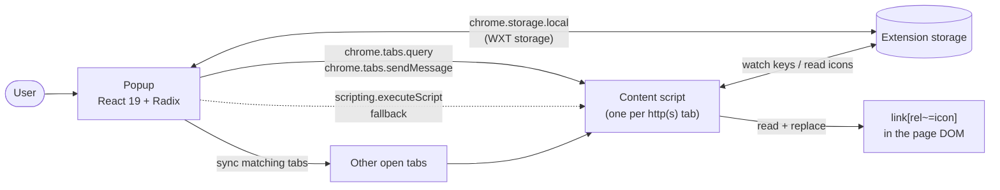
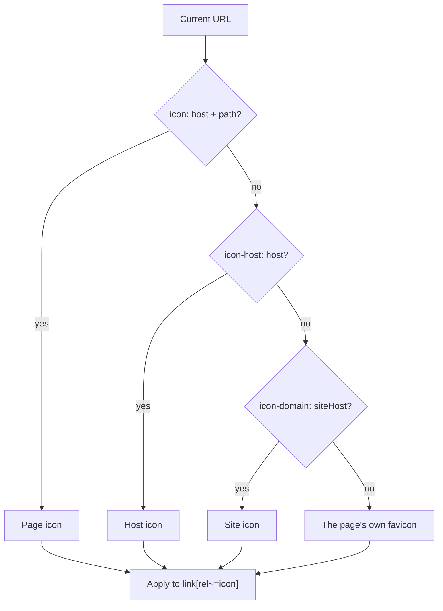
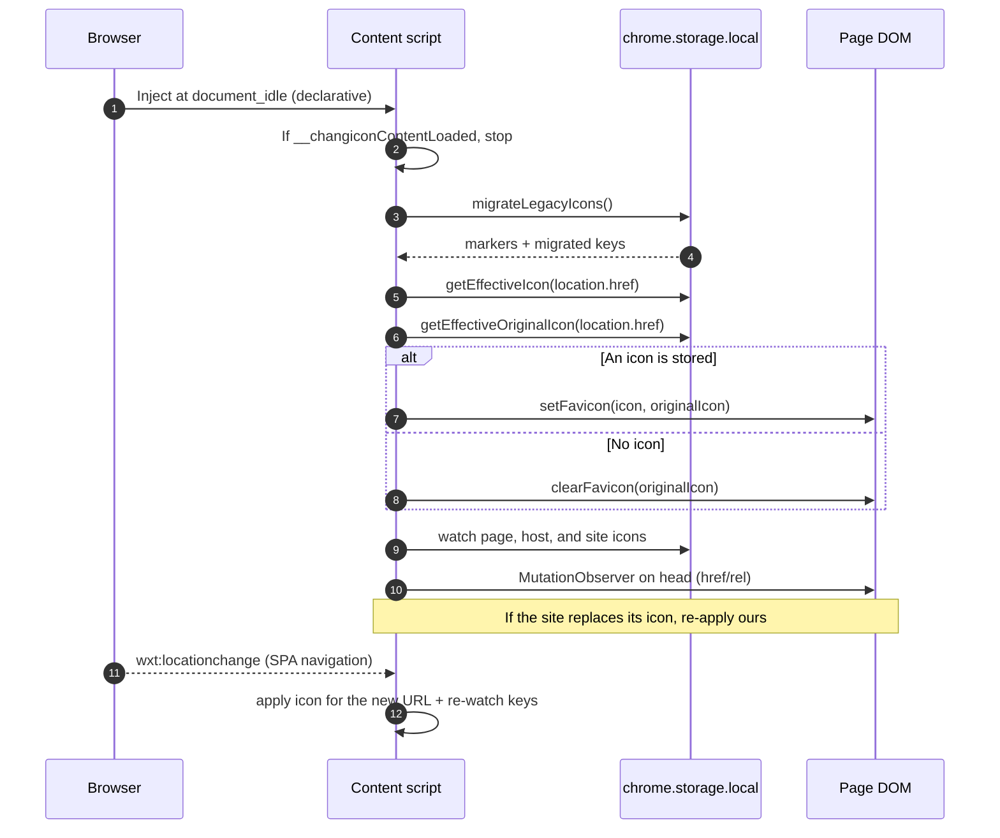
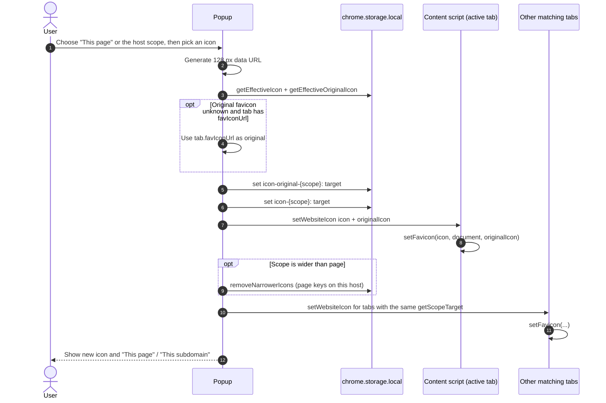
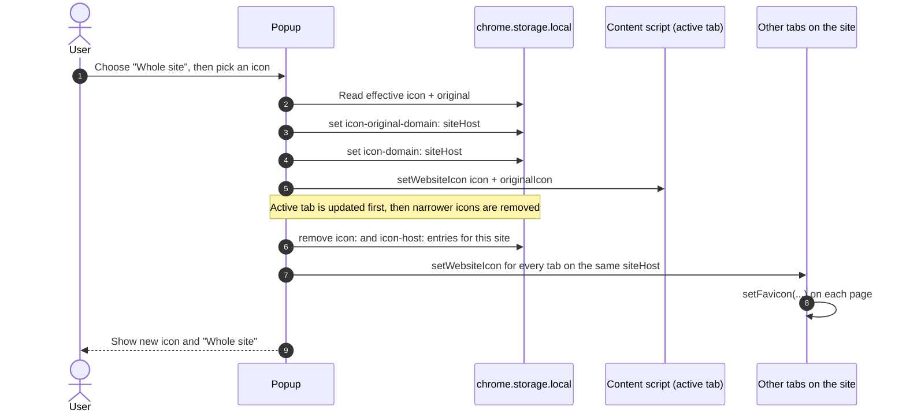
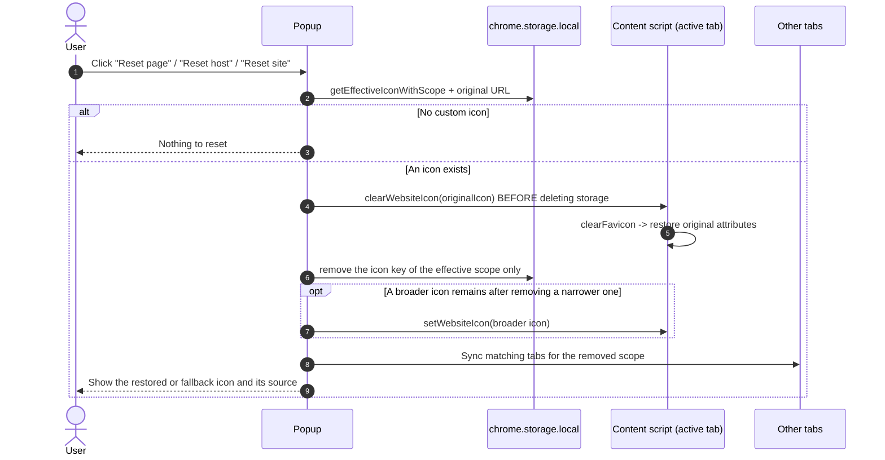
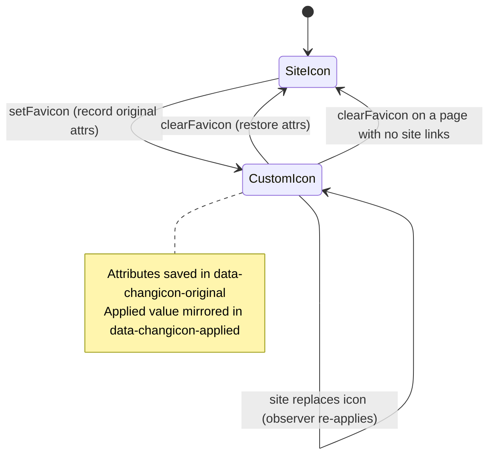
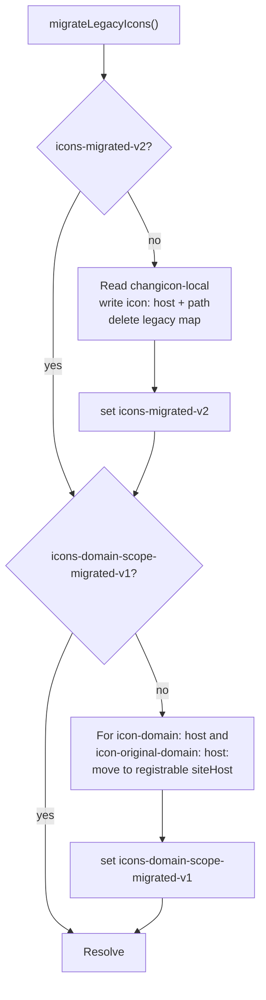
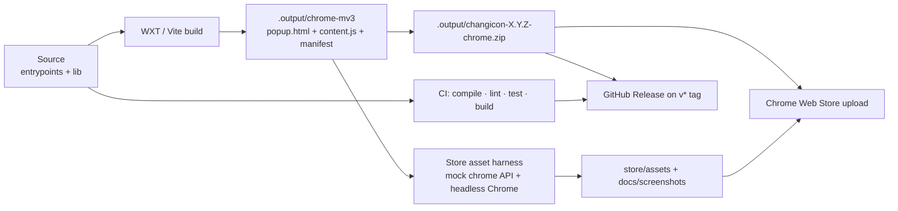

# Architecture

<!-- release: 1.1.0 -->

This document describes how Changicon works at runtime and how the codebase is
organized. It is the reference for maintainers and for agents changing the
extension. The diagrams are Mermaid and render directly on GitHub.

- Applies to: **v1.1.0**
- Source of truth: `entrypoints/`, `lib/`, `components/`, `wxt.config.ts`
- Related docs: [Release process](release-process.md) · [Store assets](../store/README.md)

---

## 1. What the extension does

Changicon replaces the favicon (the icon shown in a browser tab) of `http(s)`
pages with an icon the user creates:

| Input | Generated value |
| --- | --- |
| Up to 2 characters | 128 px PNG data URL, white rounded tile or transparent |
| One emoji | 128 px PNG data URL, white rounded tile or transparent |
| A Lucide icon | SVG data URL, white rounded tile or transparent |
| An uploaded image (PNG/JPG/WebP/GIF/SVG, ≤ 5 MB) | 128 px PNG data URL, cropped to fill or fitted whole |

An icon can be saved for **one page** (`host + pathname`), for **one host**
(every path on that hostname, including its port), or for a **whole site**
(registrable domain, including subdomains). The narrower scope wins: page over
host, host over site. Everything is generated and stored locally; the extension
makes no network requests and has no accounts, telemetry, or remote code.

Non-goals: changing page content, syncing icons between devices, replacing the
browser's own UI, or customizing `chrome://` pages and the Chrome Web Store
(Chrome does not allow content scripts there).

---

## 2. Runtime topology

There is **no background service worker**. The popup is the control surface and
content scripts are the only code that runs on web pages.



### Contexts

| Context | Entry point | Lifetime | Responsibilities |
| --- | --- | --- | --- |
| Popup | `entrypoints/popup/main.tsx` → `App.tsx` | While the popup is open | Read the active tab, render pickers/settings, write storage, message tabs, sync already-open tabs |
| Content script | `entrypoints/content.ts` | Page lifetime | Apply the effective icon, restore originals, watch storage and URL changes, re-assert the icon after SPA navigations |
| Page (DOM) | — | Page lifetime | Holds the `<link rel="icon">` elements that Chromium reads for the tab image |

`wxt.config.ts` declares `storage`, `activeTab`, and `scripting` permissions
plus `host_permissions: ["*://*/*"]`. The content script is declarative
(`matches: ["*://*/*"]`) and runs in the top frame only.

### Why no background worker

Every action starts from a user gesture in the popup. Tabs opened **before**
install/update do not have the declarative content script, so the popup injects
it on demand with `chrome.scripting.executeScript`; no always-on process is
needed for that. This keeps the permission surface and the review story small.

---

## 3. Module map

```
entrypoints/
  popup/
    main.tsx            mounts React, applies the mirrored theme before paint
    App.tsx             active-tab load, apply/reset/clear-all orchestration,
                        open-tab sync, injection fallback
  content.ts            declarative content script: migrations, initial apply,
                        storage watchers, MutationObserver, SPA URL changes
components/
  icon-display.tsx      current icon, source label (page/host/site), reset label
  setting-icon.tsx      Emoji / Icon / Text / Upload action list
  emoji-icon/           lazy emoji-mart wrapper + picker
  icons-icon/           lazy Lucide grid + search
  text-icon.tsx         up-to-2-character popover
  upload-icon.tsx       file input, cover/contain fit, 5 MB limit
  settings-panel.tsx    "Apply to" scope and "Background" preferences
  theme-provider.tsx    dark/light/system, localStorage mirror, media query
  icon-settings-provider.tsx  background + scope context, storage sync
  contact.tsx           GitHub/X links and "Clear all" confirmation
hooks/usePopupHeight.ts ref-counted popup growth while large panels are open
lib/
  icon-key.ts           pure URL → storage-key helpers, registrable-site logic
  store.ts              WXT storage items for theme/background/scope
  icons.ts              CRUD, precedence, migrations, storage watchers
  favicon-dom.ts        setFavicon / clearFavicon, original-attribute capture
  messaging.ts          typed popup ↔ content protocol
  icon-image.ts         canvas/SVG generation and image resizing
  theme.ts              theme class + mirror helpers
  utils.ts              tiny logger / class names
```

`lib/icon-key.ts`, `lib/favicon-dom.ts`, and the icon generators are covered by
Vitest (`*.test.ts`). There is no DOM integration test runner; the store asset
harness (section 11) exercises the real popup bundle.

---

## 4. Storage model

All values live in `chrome.storage.local`. Storage keys are the public contract
between the popup and every content script; **do not rename them without a
migration**.

| Key | Value | Written by | Meaning |
| --- | --- | --- | --- |
| `changicon-theme` | `"dark" \| "light" \| "system"` | Popup | Theme preference (default `system`) |
| `changicon-background` | `"white" \| "transparent"` | Popup | Background for newly generated icons (default `white`) |
| `changicon-scope` | `"page" \| "host" \| "domain"` | Popup | Where the next icon is applied (default `page`) |
| `icon:{host}{pathname}` | data URL | Popup | Page-specific icon |
| `icon-original:{host}{pathname}` | URL | Popup | The page's own favicon before the first override |
| `icon-host:{host}` | data URL | Popup | Icon for every path on one host |
| `icon-original-host:{host}` | URL | Popup | The host's original favicon before the first override |
| `icon-domain:{siteHost}` | data URL | Popup | Site-wide icon |
| `icon-original-domain:{siteHost}` | URL | Popup | The site's own favicon before the first override |
| `changicon-local` (legacy) | `{ host: { pathname: { customIcon } } }` | Old versions | Migrated to per-page keys and deleted |
| `icons-migrated-v2` | `true` | Content/popup | Legacy-map migration completed |
| `icons-domain-scope-migrated-v1` | `true` | Content/popup | Host-keyed site icons moved to registrable-domain keys |

Notes:

- `host` includes the port; the protocol is intentionally ignored, so
  `http://example.com/a` and `https://example.com/a` share an icon. Host scope
  keeps the port, so `localhost:3000` and `localhost:4000` stay independent.
- `siteHost` is the registrable domain: `news.example.co.uk` → `example.co.uk`.
  IP addresses, `localhost`, and hosts without a dot fall back to the full
  `host` (including port).
- Host and site keys can carry the same hostname (an apex domain such as
  `example.com`); they are different scopes because the site scope also covers
  subdomains. Applying a site icon removes the same-host entry, or it would
  shadow the site icon on the apex.
- Values are data URLs (PNG base64 or URL-encoded SVG), typically 2–20 KB at
  128 px. `chrome.storage.local` has a 10 MB quota; there is no `unlimitedStorage`
  permission.

### Precedence



- Applying a **host** icon removes page overlays on that host; applying a
  **site** icon removes page and host overlays across the whole site, so the
  wider icon is uniform in its range.
- `getScopeOptions` hides the site scope for `localhost` and IP addresses,
  where host and site would be the same choice.
- Resetting an icon reveals the next broader scope: page → host → site → the
  page's own favicon. The content script is sent the fallback immediately and
  other tabs are synced.

---

## 5. Flows

### 5.1 Page load (init)

The content script runs on every `http(s)` page load. Migrations are idempotent
and shared by the popup and content scripts.



Key implementation points:

- `__changiconContentLoaded` on `window` prevents double registration when the
  popup injected the same script into an already-open tab.
- `getEffectiveIcon` reads the page key, then the host key, then the site key.
- The observer only acts when `currentIcon` is non-null and the page's own
  `link[rel~=icon].href` no longer equals our icon. It does not fight the site
  when no custom icon is active.
- `ctx.onInvalidated` disconnects the observer and unsubscribes storage
  watchers when the extension updates or is removed.

### 5.2 Apply an icon to a page or host



- `sendToTab` first tries `tabs.sendMessage`; if the tab has no content script
  (it was open before install/update), it calls `injectContentScript` with the
  manifest's content-script files and retries once.
- `syncMatchingTabs` compares `getScopeTarget(tab.url, scope)`, so page scope
  matches the same `host + pathname`, host scope the same `host`, and site scope
  the same registrable domain.
- On failure the popup restores the previous icon at that scope (or removes the
  key) and shows an inline error.

### 5.3 Apply an icon to a whole site



- The site key uses the **registrable domain**, so `www.example.com`,
  `news.example.com`, and `example.com` share one icon.
- Existing page and host overlays are removed **after** the active tab
  succeeds, so a failed write does not silently destroy narrower icons. The
  rollback path restores the previous site icon; it does not restore removed
  overlays.
- `removeNarrowerIcons(url, 'domain')` also removes a host entry for the apex
  hostname, which would otherwise shadow the site icon there.
- Other tabs are matched by `getSiteHost(tab.url)` and receive the effective
  icon (or a clear message when no icon applies).

### 5.4 Reset and clear all



`clearWebsiteIcon` is sent **before** the storage key is removed. The content
script then still knows which original favicon to restore; relying only on the
storage watcher would lose that value.

"Clear all" removes every `icon:`, `icon-host:`, `icon-domain:`, and matching
`icon-original*` key, leaves theme/background/scope intact, clears the active
tab, and syncs the site's other tabs. Tabs elsewhere clear through their own
storage watchers.

### 5.5 SPA navigation and the favicon observer

Single-page apps change the URL without a page load and often replace the
favicon themselves. The content script handles both:

1. `wxt:locationchange` fires on `history.pushState`/`replaceState` and
   `popstate`; the script re-reads the effective icon for the new URL and
   re-subscribes the storage watchers to the new key.
2. A `MutationObserver` watches `<head>` for `href`/`rel` changes. When a custom
   icon is active and the site changed its own link, the custom icon is
   re-applied.

The reactive cases are bounded: the observer ignores changes when
`currentIcon` is `null`, and the storage watchers are unsubscribed on
invalidation.

### 5.6 Favicon DOM state machine

`lib/favicon-dom.ts` keeps the page's original `<link rel="icon">` elements
alive and only rewrites their attributes. It never clones or removes the site's
links unless the page had no icon at all.



Two cases:

| Page has `<link rel="icon">` | Behavior |
| --- | --- |
| Yes | For each link, record `href/type/sizes/media` once (JSON in `data-changicon-original`), then set `href` to the data URL. On reset, restore the recorded attributes. |
| No | Create/reuse a single `#changicon-favicon` link. On reset, **keep** the link pointing at the original URL (the provided favicon URL or `/favicon.ico`) instead of deleting it. Deleting it makes Chromium keep showing the custom image on pages that relied on the implicit `/favicon.ico`. |

`data-changicon-applied` stores the value we wrote. If the site changes the href
while our icon is displayed, the new href becomes the recorded original (so a
later reset restores the newest site icon), but changes caused by our own icon
switch are ignored.

`describeIcon` maps SVG data URLs to `type="image/svg+xml" sizes="any"` and
everything else to `type="image/png"` with no `sizes` claim (saved icons can be
32 px from older versions or 128 px now).

### 5.7 Migrations



- Migrations are guarded by a module-level promise, so popup and content
  scripts share one run per context and failures are retried on the next call.
- Existing keys win: a site key that already exists is not overwritten by the
  host-keyed value.
- Both migrations run from the popup before reading icons and from the content
  script before the initial apply.

---

## 6. Popup behavior

### Layout and state

| Area | Component | Data |
| --- | --- | --- |
| Header | `Header` / `ModeToggle` | theme |
| Current icon | `IconDisplay` | effective icon, source (`page`/`host`/`domain`), reset label, error |
| Actions | `SettingIcon` | Emoji, Icon, Text, Upload popovers |
| Settings | `SettingsPanel` | scope (`This page` / host scope / `Whole site`), background (`White`/`Transparent`) |
| Footer | `Contact` | X, GitHub, clear-all confirmation |

`IconSettingsProvider` loads `changicon-background` and `changicon-scope` and
watches both; `ThemeProvider` loads `changicon-theme`, mirrors it to
`localStorage` for a flash-free first paint, applies the `dark`/`light` class,
and follows `prefers-color-scheme` when the setting is `system`.

The popup is 320 px wide (`popup.html` inline style). Large pickers use
`usePopupHeight` to grow `html`/`body` to 600 px while open; a ref count keeps
the popup expanded when one panel closes during another's open animation, and
a 100 ms delay lets the 150 ms exit animation finish before collapsing.

### Active-tab load

1. `migrateLegacyIcons()`.
2. `chrome.tabs.query({active:true,currentWindow:true})`; unsupported URLs show
   "This page can't be customized".
3. `getEffectiveIconWithScope` reads page, then host, then site scope; show the
   tab's own `favIconUrl` when none exists.
4. The source label and reset label follow the stored source: `This page` →
   `Reset page`, `Whole site` → `Reset site`. The host scope is named for the
   current URL by `components/scope-labels.ts`: `This subdomain` /
   `Reset subdomain`, `This domain` on an apex domain, and `This server` on
   localhost or an IP address. Every scope option also shows its concrete target
   as a second line (`news.example.com`, `example.com, no subdomains`,
   `example.com and all subdomains`), so `This domain` and `Whole site` stay
   distinguishable on an apex domain.
5. The scope select shows the scopes that make sense for the URL
   (`getScopeOptions`), and `resolveScope` maps a stale preference (for example
   `"domain"` on localhost) onto the host scope. The hint under the select names
   the exact host or domain the choice covers.

### Failure behavior

| Failure | Handling |
| --- | --- |
| No content script in the tab | Inject the manifest's content scripts and retry once |
| Tab cannot be scripted (`chrome://`, Web Store) | `isSupportedUrl` rejects before applying; error shown |
| Storage write fails | Previous icon at the same scope restored where possible; inline error |
| Migrations fail | Logged; the promise is cleared so a later call retries |
| Icon image fails to decode in `IconDisplay` | The failed URL is remembered and a new icon is retried |

---

## 7. Icon generation

All generation happens in the popup with the Canvas API and `XMLSerializer`.

| Function | Output | Notes |
| --- | --- | --- |
| `generateTextDataUrl(text, cfg)` | PNG data URL | Max 2 code points; white mode shrinks the font until it fits; transparent mode scales the glyph's ink bounds to 94% |
| `generateEmojiDataUrl(emoji, cfg)` | PNG data URL | Same tile/transparent logic |
| `generateSvgDataUrl(svg, cfg)` | SVG data URL | Clones the Lucide SVG, expands the `viewBox` for padding, adds a white rounded `rect` when configured |
| `resizeImageToDataUrl(file, cfg, fit)` | PNG data URL | 5 MB limit, `cover` crops to fill, `contain` letterboxes; rounded clip |

Shared constants: **128 px** canvas, **16 px** padding on the white tile,
corner radius `size / 4`, emoji font stack, upload limit **5 MB**. Text icons
from older versions may be 32 px; the favicon writer intentionally does not
claim a fixed `sizes` value.

Uploads accept `image/*` from the file picker. The code rejects non-images,
files over 5 MB, unreadable images, and a missing canvas context with a user-
facing error.

---

## 8. Messaging protocol

`lib/messaging.ts` defines a typed protocol with `@webext-core/messaging`:

| Message | Payload | Returns | Sender |
| --- | --- | --- | --- |
| `setWebsiteIcon` | `{ icon, originalIcon? }` | `true` | Popup → content script |
| `clearWebsiteIcon` | `originalIcon?` | `string \| null` (restored URL) | Popup → content script |
| `ping` | — | `true` | Popup (availability probe) |

The content script registers handlers at startup. Message delivery is
per-tab (`sendMessage(type, data, tabId)`); there is no broadcast channel. The
popup discovers tabs with `chrome.tabs.query({})` and sends to the matching
ones explicitly, which keeps behavior observable and avoids a background
message router.

---

## 9. Security and privacy

| Property | Implementation |
| --- | --- |
| Network | No `fetch`/XHR/WebSocket to remote origins; all icons are local data URLs |
| Remote code | None; no dynamically imported remote scripts, no `eval` |
| Page data | The popup reads the active tab's URL and `favIconUrl`; content scripts read/write only `<link rel="icon">` attributes |
| Storage | `chrome.storage.local`; no `sync`, no external server |
| Permissions | `storage` (settings/icons), `activeTab` (current URL/favicon on click), `scripting` (inject into pre-existing tabs), host access `*://*/*` (content script must reach any page the user customizes) |
| Tracking | None |
| Data deletion | Reset removes one icon; "Clear all" removes all icon keys; uninstalling removes extension storage |

The broad host permission is the main review-sensitive surface. The extension
does not read page text, form values, cookies, or network requests. See
[`store/README.md`](../store/README.md#permissions-and-privacy-practices) for the
exact dashboard justifications.

### Known limitations

- Only the top frame is customized (`all_frames` is not enabled).
- `chrome://`, `chrome-extension://`, the Chrome Web Store, and PDF viewer pages
  cannot run content scripts.
- Site scope uses a bundled list of common multi-level suffixes, not the full
  Public Suffix List; uncommon suffixes may be treated as the last two labels.
- Storage is local to the browser profile and capped at 10 MB; there is no
  cross-device sync.
- A site that renders its favicon in a canvas or through a non-`<link>` mechanism
  may not be overridable.
- Page keys ignore the query string and hash; two URLs that differ only there
  share a page icon.
- Host keys include the port, while site keys do not: a site icon covers every
  port of the registrable domain, a host icon only the current one.

---

## 10. Build and release



- `wxt build` produces `.output/chrome-mv3`; `wxt zip` builds again and writes
  `.output/changicon-<version>-chrome.zip`.
- The manifest version comes from `package.json`; never edit the built manifest.
- `store:assets` rebuilds the popup, mounts it in a mock extension environment,
  and captures the real UI with headless Chrome (see section 11).
- `scripts/release-docs.test.ts` runs in `pnpm test` (and therefore `pnpm check`
  and CI). It fails when the docs release marker, the changelog entry, or a store
  asset is out of date.
- The GitHub release workflow runs on `v*` tags: checks, zip, GitHub Release
  with the zip attached. Chrome Web Store submission is manual in 2026 because
  the legacy v1.1 API used by WXT 0.20 is retired; see
  [Release process](release-process.md#chrome-web-store-submission).

---

## 11. Store screenshot harness

`scripts/store/build-assets.mjs` is a development tool, not shipped code:

1. Copies the built `chrome-mv3` output to `.store-demo/`.
2. Injects `mock-chrome.js` (storage/tabs/runtime/scripting), `scenario.js`
   (opens a picker, types text, chooses a fake file), and a no-animation style.
3. Serves the directory on `127.0.0.1` and captures the real popup with headless
   Chrome at 2× for README images and composes 1280×800 store frames.
4. Verifies every PNG's dimensions and rejects an alpha channel before writing
   to `store/assets/`.

The mock is intentionally minimal and mirrors only the APIs the popup calls. It
does not simulate the content script or the Chrome Web Store.

---

## 12. Invariants for contributors

1. **Storage keys are a contract.** Add a migration and a marker; never reuse a
   key with a different shape.
2. **Narrower beats wider.** `getEffectiveIcon` must keep page > host > site,
   and reset must reveal the next broader icon.
3. **Restore, don't delete.** For pages without an icon link, keep the
   `#changicon-favicon` link on reset so Chromium refreshes the tab image.
4. **No network.** Icons are data URLs; no remote assets, fonts, or code.
5. **No background worker.** Keep actions popup-driven; use the injection
   fallback for pre-existing tabs.
6. **Site scope is the registrable domain.** Update the suffix list and tests
   together.
7. **Every release updates docs.** The `<!-- release: -->` marker and changelog
   entry are checked by the release-docs test in `pnpm test`.
